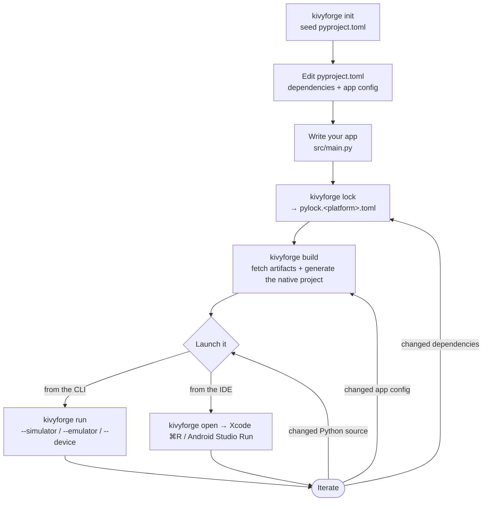

# kivyforge


[](https://opencollective.com/kivy)
[](https://opencollective.com/kivy)
[](https://github.com/ElliotGarbus/kivyforge/blob/main/CODE_OF_CONDUCT.md)


[](https://github.com/ElliotGarbus/kivyforge/actions/workflows/kivyforge.yml)

kivyforge is a declarative, [PEP 621](https://peps.python.org/pep-0621/)-aligned
build toolchain for [Kivy](https://kivy.org) apps. You describe your app once in
`pyproject.toml`. kivyforge resolves your dependencies into a lockfile, downloads
a prebuilt Python runtime and prebuilt wheels, and drives the platform's own
tools to produce a signed app. It is the successor to **kivy-ios**,
**python-for-android**, and **buildozer**, with one workflow for every platform
Kivy runs on: **Android, iOS, macOS, Windows, and Linux (including Raspberry
Pi)**.

📖 **Documentation:** <https://elliotgarbus.github.io/kivyforge/> — installation,
quickstarts for every platform, the configuration and CLI reference, and
troubleshooting.

> **Status: beta.** All five platforms build, run, and package, tested in CI and
> by hand on real hardware. Configuration keys and command options
> can still change between releases, and the
> [release notes](https://elliotgarbus.github.io/kivyforge/release-notes/) list
> each change. If an app of yours ships with kivy-ios, python-for-android, or
> buildozer today, try kivyforge on a branch and keep your current toolchain
> until you have tested the result.
>
> **Known issue:** on iOS 27, rotating a Kivy app breaks its layout until a new
> SDL and Kivy wheel ship
> ([#195](https://github.com/ElliotGarbus/kivyforge/issues/195)).
>
> **On iOS, kivyforge builds Kivy 3 only**, and Kivy 3.0 is not released yet, so
> iOS apps use its development snapshots. Apps on Kivy 2.x stay on kivy-ios for
> now. Android builds either Kivy 2.3.1 or a Kivy 3.0 snapshot, and the desktop
> targets use Kivy 2.3.1 from PyPI.

## Help test kivyforge

We're looking for beta testers. The most useful test is your own app: move one
from buildozer, python-for-android, or kivy-ios
([migration guide](https://elliotgarbus.github.io/kivyforge/guides/cross-platform/migrate/)),
or start from a
[quickstart](https://elliotgarbus.github.io/kivyforge/get-started/quickstart-desktop/).
We'd especially like reports on what we haven't been able to test ourselves:

- Uploading an App Bundle to Google Play, and an `.ipa` to App Store Connect and
  TestFlight.
- Authenticode signing with a publicly trusted certificate.
- A Raspberry Pi 4, and running on a free Apple ID's personal team.
- Linux distributions other than Ubuntu, and phones and tablets of every kind.

Tell us what worked as well as what didn't. To report a problem, see
[Report a problem](https://elliotgarbus.github.io/kivyforge/troubleshooting/#report-a-problem)
for what to include, then
[open an issue](https://github.com/ElliotGarbus/kivyforge/issues).

## Supported targets

| Target | Architectures | Output | Signing | Build host |
|---|---|---|---|---|
| [iOS](https://www.apple.com/ios/) device | arm64 (iPhone / iPad) | generated Xcode project → `.app` / `.ipa` | Apple Development or Distribution, through Xcode | macOS + [Xcode](https://developer.apple.com/xcode/) |
| iOS Simulator | arm64 | generated Xcode project → `.app` | none required | macOS + Xcode |
| [Android](https://www.android.com/) device / emulator | `arm64_v8a`, `x86_64` | generated Gradle project → `.apk` / `.aab` | debug key, or your release keystore | Windows, macOS, or Linux + JDK, Android SDK, and NDK |
| [macOS](https://www.apple.com/macos/) | arm64 (Apple Silicon) | `.app` | ad-hoc (default), or Developer ID + notarization | macOS (Apple Silicon) |
| [Linux](https://appimage.org/) | x86_64 (glibc ≥ 2.17) | `.AppImage` / AppDir | none | x86_64 Linux |
| [Raspberry Pi](https://www.raspberrypi.com/) (Pi 4 / Pi 5, 64-bit Raspberry Pi OS) | aarch64 | `.AppImage` | none | x86_64 Linux (cross-build; WSL2 works) |
| [Windows](https://learn.microsoft.com/windows/) | amd64 | folder with a windowed launcher `.exe` | optional Authenticode (unsigned by default) | Windows |

Desktop apps carry their own Python runtime and wheels. On Linux, libGL/EGL and
X11/Wayland come from the machine that runs the app. Raspberry Pi is tested on a
Pi 5; the Pi 4 is supported but untested, and 32-bit Raspberry Pi OS is not
supported.

**Apple targets are Apple Silicon only.** kivyforge does not build Intel
(`x86_64`) macOS apps or pin the Intel iOS Simulator slice: macOS 27 stops
installing on Intel hardware and macOS 28 removes Rosetta, so an Intel slice
would be one nothing can execute or validate. `universal2` *wheels* are still
resolved normally, because they contain arm64.

kivyforge builds on the work of the [Kivy Team](https://kivy.org/about.html).

## Installation

kivyforge is a command-line tool and needs Python 3.13 or newer. The recommended
installer is [uv](https://docs.astral.sh/uv/), which installs it into its own
isolated environment and puts `kivyforge` on your `PATH`:

```bash
uv tool install kivyforge
```

If your shell reports that `kivyforge` is not found, run `uv tool update-shell`
and open a new terminal. Upgrade or remove it later with
`uv tool upgrade kivyforge` / `uv tool uninstall kivyforge`.

Alternatives: [pipx](https://pipx.pypa.io/) (`pipx install kivyforge`), or pip
inside a virtual environment (`pip install kivyforge`).

Check the install with `kivyforge --version` and `kivyforge capabilities`. The
install also provides a short alias, `kf`. For the full walk-through, see
[Install kivyforge](https://elliotgarbus.github.io/kivyforge/get-started/install/).

## Requirements

kivyforge detects each target's toolchain but never installs one. Run
`kivyforge doctor -p <platform>` on your machine to see what is missing.

| Target | You need |
|---|---|
| iOS | A Mac with the full [Xcode](https://developer.apple.com/xcode/) 15 or newer, selected with `sudo xcode-select --switch /Applications/Xcode.app` and its license accepted with `sudo xcodebuild -license`. The command-line tools alone are not enough. |
| Android | A JDK 17 to 23, on `PATH` or in `JAVA_HOME`. The Android SDK with build-tools, platform-tools, and recorded licenses. The [NDK](https://developer.android.com/ndk), which every build uses. Android Studio's SDK Manager installs them; see the [Android quickstart](https://elliotgarbus.github.io/kivyforge/get-started/quickstart-android/). |
| macOS | The Xcode command-line tools (`xcode-select --install`). |
| Windows | Nothing extra. `signtool` from the Windows SDK if you sign. |
| Linux | An x86_64 Linux machine. WSL2 works. To run the app: `libGL` and `libEGL`, and an X11 or Wayland session. |

## Quick start

The fastest way to see kivyforge work is to build an example, as the
[quickstarts](https://elliotgarbus.github.io/kivyforge/get-started/quickstart-desktop/)
do. The commands below are for your own app. Run them from the directory that
holds your `pyproject.toml`, which needs a `[project]` table with at least `name`
and `version`. Your code goes in `src/`, starting with `src/main.py`.

Every platform follows the same steps: `init` adds the configuration, with `TODO`
markers on the values to change, `lock` resolves dependencies, `build` and `run`
are the development loop, and `package` produces the distributable.

### iOS

Depend on Kivy 3 in `[project].dependencies`, for example
`"kivy>=3.0.0.dev0,<4"`, and set `requires-python` to allow Python 3.15.

```bash
kivyforge init -p ios                 # add [tool.kivy] and [tool.kivy.ios]
kivyforge lock -p ios                 # write pylock.ios.toml
kivyforge run -p ios --simulator      # build, install, and launch
kivyforge open -p ios                 # or open the generated project in Xcode
kivyforge package -p ios              # dist/ios/<name>-<version>.ipa
```

Running on a device and `package` need signing; see
[Sign the app](https://elliotgarbus.github.io/kivyforge/guides/ios/signing/).

### Android

```bash
kivyforge init -p android             # add [tool.kivy] and [tool.kivy.android]
kivyforge lock -p android             # write pylock.android.toml
kivyforge run -p android              # build, install, launch, and follow the log
kivyforge package -p android          # dist/android/<name>-<version>.apk
kivyforge package -p android -f aab   # dist/android/<name>-<version>.aab, for Google Play
```

`run` picks a connected device, else a running emulator, else it boots your first
AVD. `package` needs a release keystore; see
[Sign and publish to Google Play](https://elliotgarbus.github.io/kivyforge/guides/android/signing/).

Kivy has no Android wheel on PyPI, so `init` adds the first-party
[kivy-mobile-wheels](https://github.com/ElliotGarbus/kivy-mobile-wheels) index to
`extra_index_urls`. Any other dependency with compiled code must publish an
`android_*` wheel, or you supply one through `find_links`. `lock` fails and names
the package otherwise. Only 64-bit ABIs are supported.

`kivy_generation = 2` targets Kivy 2.3.1 on SDL2, and `kivy_generation = 3`
targets a Kivy 3.0 snapshot on SDL3, which you also request in your dependencies;
see [Configure your Android app](https://elliotgarbus.github.io/kivyforge/guides/android/configure/).

### macOS

```bash
kivyforge init -p macos               # add [tool.kivy] and [tool.kivy.macos]
kivyforge lock -p macos               # write pylock.macos.toml
kivyforge run -p macos                # build build/macos/<App>.app and launch it
kivyforge package -p macos            # sign build/macos/<App>.app for distribution
```

Without signing configuration, `package` ships an **ad-hoc** signature: it runs on
your Mac, and Gatekeeper blocks downloaded copies. To distribute it, add a
Developer ID identity and a notary profile, and the same command signs, notarizes,
and staples the app; see
[Sign, notarize, and staple](https://elliotgarbus.github.io/kivyforge/guides/macos/signing/).

### Linux

```bash
kivyforge init -p linux               # add [tool.kivy] and [tool.kivy.linux]
kivyforge lock -p linux               # write pylock.linux.toml
kivyforge run -p linux                # build build/linux/<App>.AppDir and launch it
kivyforge package -p linux            # dist/linux/<name>-<version>-x86_64.AppImage
kivyforge package -p linux -f folder  # or a run-from-folder AppDir
```

The AppImage embeds a static-FUSE runtime, so recipients need no `libfuse2`. It
never bundles libGL/libEGL or a display server; see
[Meet the Linux host requirements](https://elliotgarbus.github.io/kivyforge/guides/linux/host-requirements/).

### Raspberry Pi

Raspberry Pi is a **Linux** target, not a separate platform. Set
`archs = ["aarch64"]` in `[tool.kivy.linux]`, cross-build on an x86_64 Linux
machine (WSL2 works), and copy the AppImage to a Pi 4 or Pi 5 running 64-bit
Raspberry Pi OS with a desktop. You do not install kivyforge on the Pi.

```bash
kivyforge lock -p linux
kivyforge package -p linux --arch aarch64   # dist/linux/<name>-<version>-aarch64.AppImage
```

See [Build for Raspberry Pi](https://elliotgarbus.github.io/kivyforge/guides/linux/raspberry-pi/).

### Windows

```bash
kivyforge init -p windows             # add [tool.kivy] and [tool.kivy.windows]
kivyforge lock -p windows             # write pylock.windows.toml
kivyforge run -p windows              # build build\windows\<App>\ and launch it
kivyforge package -p windows          # dist\windows\<App>-<version>-amd64\
```

Double-clicking the launcher opens the app with no console window, and
`kivyforge run` attaches it to your terminal so you see tracebacks. Signing is
optional; see
[Sign with Authenticode](https://elliotgarbus.github.io/kivyforge/guides/windows/signing/).

## Examples

The [`examples/`](https://github.com/ElliotGarbus/kivyforge/tree/main/examples)
folder holds complete, copy-pasteable apps. None of them needs you to build a
wheel: desktop examples use Kivy 2.3.1 from PyPI, and mobile examples get Kivy
from the
[kivy-mobile-wheels](https://github.com/ElliotGarbus/kivy-mobile-wheels) index.

**Desktop** ([`examples/desktop/`](https://github.com/ElliotGarbus/kivyforge/tree/main/examples/desktop)):

- `dice-roller`: a minimal Kivy UI that builds on macOS, Linux (x86_64 and
  Raspberry Pi), and Windows.
- `notes`: a Kivy app with a pure-Python dependency (`platformdirs`).
- `desktop-viewer`: a macOS-only app with a resizable window, ⌘ keyboard
  shortcuts, and Finder's open panel.
- `hello-native`: ships native binaries that don't come from a wheel, a helper
  executable and a shared library, on all three desktops.

**iOS** ([`examples/mobile/`](https://github.com/ElliotGarbus/kivyforge/tree/main/examples/mobile), on Kivy 3.0):

- `hello-world`: a Kivy-free toolchain smoke test with no dependencies.
- `hello-kivy`: a minimal Kivy 3.0 UI.
- `mobile-geometry`: shows the `kivy.mobile` runtime geometry API: DPI, safe-area
  insets, and keyboard height. It also runs on Android.
- `svg-explorer`: an SVG viewer with multitouch pan, zoom, and rotate.
- `rubicon-ball`: calls CoreMotion and UIScreen from Python through Rubicon-ObjC,
  including a C struct return.
- `rubicon-deviceinfo`: reads device info (model, system version, battery) through
  Rubicon-ObjC.
- `keychain-spm`: pins a remote Swift package (`KeychainAccess`) and calls it from
  Python through a local `@objc` shim.
- `swift-bridge`: calls Swift from Python: objects with state, collections, a
  throwing method, `async` work, and a Swift delegate protocol implemented in
  Python.
- `ios-lifecycle-hook`: runs Objective-C before Python to add the app-delegate
  methods SDL lacks, and delivers them to Python as Kivy events.
- `ios-webview`: shows a `WKWebView` over the Kivy window.

**Android** ([`examples/mobile/`](https://github.com/ElliotGarbus/kivyforge/tree/main/examples/mobile)):

- `hello-android`: the smallest Android app, on Kivy 2.3.1 and SDL2.
- `hello-sdl3`: the same app on Kivy 3.0 and SDL3.
- `pyjnius-deviceinfo`: reads device info through pyjnius, with no Java written.
- `qr-maven`: renders a QR code with Google's ZXing, resolved as a Maven
  dependency and driven from Python.
- `android-services`: a background and a foreground service.
- `android-activity-class`: runs Java in the activity's `onCreate`, through your
  own `PythonActivity` subclass and through a `ContentProvider`.
- `android-package`, `android-package-sdl3`: use python-for-android's `android`
  package on each Kivy generation.
- `android-fullscreen`: hides the system bars with `fullscreen = true`.
- `android-safe-area`: paints the unsafe region so you can see the insets.

## Configuring your app

Your app is described declaratively in `pyproject.toml`. Standard
[PEP 621](https://peps.python.org/pep-0621/) `[project]` metadata supplies the
name, version, and runtime `dependencies`. Shared settings live under
`[tool.kivy]`, and each target has its own `[tool.kivy.<platform>]` table: `ios`,
`android`, `macos`, `linux`, and `windows`. For example, an iOS app:

```toml
[project]
name = "hello-kivy"
version = "0.1.0"
requires-python = ">=3.14"
dependencies = ["kivy>=3.0.0.dev0,<4"]

[tool.kivy]
display_name = "Hello Kivy"             # name shown under the icon
app_dir = "src"                         # folder containing your Python source
entry_point = "main"                    # module run as __main__ at launch (main.py)
orientation = ["portrait"]

[tool.kivy.ios]
schema_version = 1
bundle_id = "org.example.hello-kivy"    # reverse-DNS; no underscores
build = 1
deployment_target = "16.0"
extra_index_urls = ["https://elliotgarbus.github.io/kivy-mobile-wheels/simple/"]
exclude = ["kivy-garden", "docutils", "pygments"]   # Kivy deps you don't use at runtime

[tool.kivy.ios.python]
version = "3.15.0"                      # python.org Python.xcframework version

[tool.kivy.ios.signing]
team_id = ""                            # Apple Developer Team ID (device / release builds)
auto_signing = true
```

Make changes in your source folder, never in the generated project: `build`
regenerates it. Every key is in the
[configuration reference](https://elliotgarbus.github.io/kivyforge/reference/pyproject/tool-kivy/).

## Commands

The verbs are platform-neutral. Each resolves a target from `-p/--platform`, the
`KIVYFORGE_PLATFORM` environment variable, or the host's own platform if
`pyproject.toml` has an overlay for it, and then does that platform's version of
the same job. iOS and Android always need `-p` or the variable.

```text
kivyforge init          Seed [tool.kivy] + the target's overlay into pyproject.toml
kivyforge lock          Generate pylock.<platform>.toml from pyproject.toml
kivyforge build         Download artifacts, generate the native project, build
kivyforge run           Build (unless --no-build), install, and launch the app
kivyforge package       Produce the signed, distributable artifact
kivyforge open          Open the generated project in Xcode / Android Studio
kivyforge status        Show app identity, Python version, lock sync, build state
kivyforge clean         Remove generated artifacts in the project folder
kivyforge upgrade       Re-fetch the pinned runtime and native artifacts
kivyforge doctor        Run environment and project health checks
kivyforge capabilities  List platforms, archs, package formats, and which hosts build what
```

Run `kivyforge <command> -h` (or `kf <command> -h`) for every option on a verb. A
few common ones:

- `kivyforge init -p ios -p android`: seed several platforms' overlays in one run.
- `kivyforge lock --check`: CI pre-flight; exits non-zero if the lock is stale.
- `kivyforge build -p ios --simulator | --device | --release`: pick the iOS build flavor.
- `kivyforge build -p android --debug [--abi arm64_v8a|x86_64]`: assemble a debug APK, optionally for one ABI.
- `kivyforge run -p ios --list-devices`: list available simulators or emulators and devices.
- `kivyforge run -p android --smoke`: run the generated on-device contract test.
- `kivyforge run --release` (Android, Linux, macOS, Windows): build and launch the release flavor, to exercise `byte_compile` and `strip_source` outside of `package`.
- `kivyforge clean --cache`: also flush the artifact download cache.

Downloaded artifacts are cached per user and shared across projects.

## Typical workflow

A normal session is a one-time setup followed by a tight edit → run loop. You only
re-run `kivyforge lock` when dependencies change, and `kivyforge build` when you
change app config (or need to regenerate the native project).

How cheap the inner loop is depends on the platform. On **iOS** the generated
project *links* your source directory (`app/` is a symlink to `app_dir`), so
editing Python source needs no rebuild — just relaunch. On **Android** the app's
code is packed into the APK's asset bundle, so a source edit needs a re-pack:
`kivyforge run` does that for you every iteration, which is why the Android loop
goes through `run` rather than a bare relaunch.



Supporting commands fit around this loop: `kivyforge status` shows whether your
lock and build are current, `kivyforge doctor` diagnoses environment problems,
`kivyforge upgrade` re-fetches the pinned runtime, and `kivyforge clean` resets
the generated project when you want a fresh build.

## Working with agents

kivyforge is designed to also be driven non-interactively — by CI, or by an
agent (Claude Code and similar) building or maintaining a Kivy app on your
behalf. No verb prompts for input, and every verb but `run` accepts `--json`.

- **Discover capabilities first:** `kivyforge capabilities --json` lists every
  platform, its architectures and package formats, **which hosts can build
  which targets**, every verb and whether it takes `--json`, and the exit-code
  and `KF-*` diagnostic-code vocabularies. It needs no project, lock, or
  network access, so it's the right first call before touching a real project.
- **`--json` puts exactly one envelope on stdout** —
  `{"schema", "kivyforge", "command", "platform", "ok", "data", "diagnostics"}`
  — on success *and* on every failure. Progress and log lines go to stderr, so
  a build log and a parseable result coexist on the same run.
- **Branch on the exit code first, then `diagnostics[].code`**: `1` — fix
  `pyproject.toml`; `2` — a bad flag (click's own usage error; kivyforge never
  raises it); `3` — fix the machine (missing toolchain); `4` — the lock is
  stale, re-run `kivyforge lock`; `5` — a build genuinely failed, read the log
  on stderr. The code is a stable contract; the human-readable message next to
  it is not, and may be reworded across releases.
- **`diagnostics` on an `ok: true` run are warnings, not failures** — an
  unsigned package, a byte-compile that silently degraded to shipping source,
  a resolver policy note. Read them; don't treat `ok: true` as "nothing to
  look at."
- **Build/package outputs are `data.artifacts`**, as `{"path", "kind"}` pairs
  relative to the project root, always posix-spelled — read that instead of
  guessing the layout, and only trust artifacts a run reports for *itself*: a
  failed run's `artifacts` never names a stale file left over from a previous
  one.
- **`run` is the one verb without `--json`.** It hands your app's own process
  the console directly (stdout/stderr pass through untouched), which is the
  point of the verb; script against `build`/`package` plus `status --json`
  instead.

## Development

Clone the repository and install it into a virtual environment:

      git clone https://github.com/ElliotGarbus/kivyforge.git
      cd kivyforge/
      python3 -m venv .venv
      . .venv/bin/activate
      pip install -e ".[dev]"

Run the same four checks CI runs:

      pytest
      ruff check kivyforge tests
      ruff format --check kivyforge tests
      pyright

To build the documentation locally, run `pip install -e ".[docs]"`, then
`mkdocs serve`. For the design documents, start with the
[design overview](https://github.com/ElliotGarbus/kivyforge/blob/main/docs/design/common/00-overview.md),
and see [AGENTS.md](https://github.com/ElliotGarbus/kivyforge/blob/main/AGENTS.md)
for the rules of working in this repository.

## FAQ

For troubleshooting advice and other frequently asked questions, consult
the latest 
[kivyforge FAQ](https://github.com/ElliotGarbus/kivyforge/blob/main/FAQ.md).

## License

kivyforge is [MIT licensed](https://github.com/ElliotGarbus/kivyforge/blob/main/LICENSE), and builds on work actively developed by a
great community and supported by many projects managed by the 
[Kivy Organization](https://www.kivy.org/about.html).

## Support

Are you having trouble using kivyforge or any of its related projects in the Kivy
ecosystem?
Is there an error you don’t understand? Are you trying to figure out how to use 
it? We have volunteers who can help!

The best channels to contact us for support are listed in the latest 
[Contact Us](https://github.com/ElliotGarbus/kivyforge/blob/main/CONTACT.md) document.

## Contributing

kivyforge builds on the [Kivy](https://kivy.org) ecosystem - a large group of
products used by many thousands of developers for free, but it
is built entirely by the contributions of volunteers. We welcome (and rely on) 
users who want to give back to the community by contributing to the project.

Contributions can come in many forms. See the latest 
[Contribution Guidelines](https://github.com/ElliotGarbus/kivyforge/blob/main/CONTRIBUTING.md)
for how you can help us.

## Code of Conduct

In the interest of fostering an open and welcoming community, we as 
contributors and maintainers need to ensure participation in our project and 
our sister projects is a harassment-free and positive experience for everyone. 
It is vital that all interaction is conducted in a manner conveying respect, 
open-mindedness and gratitude.

Please consult the [latest Kivy Code of Conduct](https://github.com/kivy/kivy/blob/master/CODE_OF_CONDUCT.md).

## Contributors

This project exists thanks to 
[all the people who contribute](https://github.com/ElliotGarbus/kivyforge/graphs/contributors).
[[Become a contributor](https://github.com/ElliotGarbus/kivyforge/blob/main/CONTRIBUTING.md)].


## Backers

Thank you to [all of our backers](https://opencollective.com/kivy)! 
🙏 [[Become a backer](https://opencollective.com/kivy#backer)]


## Sponsors

Special thanks to 
[all of our sponsors, past and present](https://opencollective.com/kivy).
Support this project by 
[[becoming a sponsor](https://opencollective.com/kivy#sponsor)].

Here are our top current sponsors. Please click through to see their websites,
and support them as they support us. 

<!--- See https://github.com/orgs/kivy/discussions/15 for explanation of this code. -->
<a href="https://opencollective.com/kivy/sponsor/0/website" target="_blank"></a>
<a href="https://opencollective.com/kivy/sponsor/1/website" target="_blank"></a>
<a href="https://opencollective.com/kivy/sponsor/2/website" target="_blank"></a>
<a href="https://opencollective.com/kivy/sponsor/3/website" target="_blank"></a>

<a href="https://opencollective.com/kivy/sponsor/4/website" target="_blank"></a>
<a href="https://opencollective.com/kivy/sponsor/5/website" target="_blank"></a>
<a href="https://opencollective.com/kivy/sponsor/6/website" target="_blank"></a>
<a href="https://opencollective.com/kivy/sponsor/7/website" target="_blank"></a>

<a href="https://opencollective.com/kivy/sponsor/8/website" target="_blank"></a>
<a href="https://opencollective.com/kivy/sponsor/9/website" target="_blank"></a>
<a href="https://opencollective.com/kivy/sponsor/10/website" target="_blank"></a>
<a href="https://opencollective.com/kivy/sponsor/11/website" target="_blank"></a>

<a href="https://opencollective.com/kivy/sponsor/12/website" target="_blank"></a>
<a href="https://opencollective.com/kivy/sponsor/13/website" target="_blank"></a>
<a href="https://opencollective.com/kivy/sponsor/14/website" target="_blank"></a>
<a href="https://opencollective.com/kivy/sponsor/15/website" target="_blank"></a>
