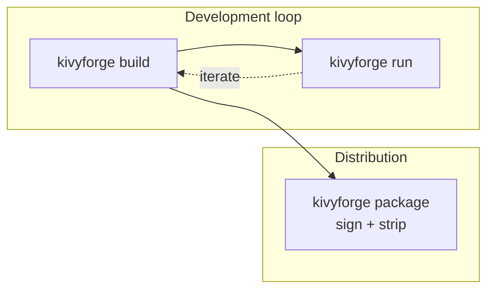

# Build versus package

kivyforge has two verbs that produce output, and they serve different purposes:
`build` for day-to-day development, and `package` for the artifact you ship.

## `build`: the development loop

`kivyforge build` downloads the runtime and pinned artifacts and generates the
native project for the target. It gets your app to a state you can open in an
IDE, launch on a simulator, or run on the host. It does not sign for
distribution, and it keeps your Python source readable, so iteration stays
quick.

`kivyforge run` builds (unless you pass `--no-build`) and then launches the app.

## `package`: the distributable

`kivyforge package` produces the finished, distributable artifact and signs it.
Signing has to operate on the bundled binaries, so it happens inside kivyforge
rather than afterward. What signing means depends on the platform:

- **iOS** and **Android**: `package` requires signing to be configured.
  On Android, `package --debug` is the exception: it packages a debug build
  and needs no keystore. A debug APK is signed with the Android SDK's debug
  key, and a debug AAB is unsigned.
- **macOS**: Developer ID signing when you configure it, otherwise an ad-hoc
  signature.
- **Windows**: Authenticode signing when you configure it, otherwise unsigned.
- **Linux**: not signed.

When `package` falls back to ad-hoc or unsigned, it reports a
`KF-SIGNING-UNCONFIGURED` warning. By default, `package` also byte-compiles
your app's Python and strips the source; `build` does neither.

## Where the output goes

`build` leaves its output in the build tree, where `run` and your IDE expect
it: `build/PLATFORM/` for the desktop platforms, and the generated
`APP_NAME-android/` or `APP_NAME-ios/` project for Android and iOS.

`package` writes the file it produces to `dist/PLATFORM/`, with your app's
version in the name:

| Platform | Where `package` puts the artifact |
|---|---|
| `linux` | `dist/linux/APP_NAME-VERSION-ARCH.AppImage`. With `-f folder`, the AppDir stays in `build/linux/`. |
| `windows` | `dist/windows/DISPLAY_NAME-VERSION-ARCH/`, a copy of the folder in `build/windows/` |
| `macos` | `build/macos/DISPLAY_NAME.app`, signed in place |
| `android` | `dist/android/APP_NAME-VERSION.apk` or `.aab`. With `--debug`, `APP_NAME-VERSION-debug.apk` or `.aab`. |
| `ios` | `dist/ios/APP_NAME-VERSION.ipa` |

`APP_NAME` is your `[project].name`, `DISPLAY_NAME` is
`[tool.kivy].display_name`, `VERSION` is your app's version, and `ARCH` is the
architecture packaged. With `--json`, the path is in `data.artifacts`.

!!! note "Preview"
    This describes behavior that is on `main` but not yet in a released
    version. It will ship in a future release. In 3.0.0.dev1 and earlier,
    Android and iOS `package` leave the artifact in the generated project.

## The `-f` format selector

`package -f FORMAT` chooses the artifact shape where a platform offers more
than one. Without `-f`, `package` uses the platform's default:

| Platform | Formats | Default |
|---|---|---|
| `ios` | `ipa` | `ipa` |
| `macos` | `app` (a `.app` bundle) | `app` |
| `windows` | `folder` (an onedir folder with a launcher `.exe`) | `folder` |
| `linux` | `appimage` (a single `.AppImage` file), `folder` (an AppDir) | `appimage` |
| `android` | `apk`, `aab` | `apk` |

On Android, `--debug` chooses the build type and `-f` the file type, as they
do on `build`: `package -p android --debug -f aab` produces a debug AAB.

## The installer boundary

kivyforge builds and signs the runnable artifact, and stops there. Wrapping that
artifact in an installer or container is out of scope; use a dedicated tool:

- macOS `.dmg`: [create-dmg](https://github.com/create-dmg/create-dmg) or similar.
- Windows installer: [Inno Setup](https://jrsoftware.org/isinfo.php), WiX, or NSIS.
- Linux `.deb`, `.rpm`, or Flatpak: your distribution's own tooling.
- App Store or Google Play submission: the store's upload tools.

## What's next

- [Package a .dmg](../guides/macos/dmg.md) or
  [create a Windows installer](../guides/windows/installer.md).
- [JSON output](../reference/json-output.md): read `data.artifacts` to find what a
  run produced.
- [CLI reference](../reference/cli.md).
